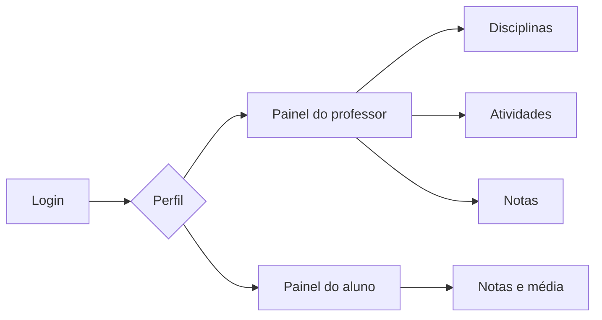

  

  # AcadFlow — Design

  Identidade visual, componentes, fluxos e telas do AcadFlow.

  [Documentação no Linear](https://linear.app/acadflow/document/acadflow-inicio-e-documentacao-9f01545a3125)

## Sobre

Este repositório reúne o design do AcadFlow, sistema para organizar disciplinas, atividades e notas. Ele é a referência visual para a [aplicação web](https://github.com/DevCaverna/acadflow-web), nas jornadas de professor e de aluno.

**Formatos:** `SVG` · `PNG` · `Canvas (.dc.html)`

## Fluxo

## Conteúdo

- `icone/`: ícone do projeto
  - `acadflow-icone.svg`: versão completa (a escrita "Acad" já está convertida em curvas, não precisa da fonte)
  - `acadflow-icone-simples.svg`: versão sem escrita, para tamanhos abaixo de 64 px
  - PNGs em 1024, 512, 192, 180 (Apple), 32 e 16 px (32 e 16 usam a versão simples)
- `design-files/`: código-fonte de todas as telas do canvas (um arquivo `.dc.html` por quadro) e `canvas.json` (páginas, posições e notas)
- `telas/`: cópia das mesmas telas separadas por página, só para consulta; para reabrir ou editar no canvas, use `design-files/`

## Páginas e quadros

| Página | Quadros |
| --- | --- |
| 01 · Capa, ícone e escopo | Main (capa), Icone, LogoMark, **EscopoMVP** |
| 02 · Fundamentos e componentes | Fundamentos, Componentes, Sidebar, **Avisos**, **TemaEscuro** |
| 03 · Fluxos e dados | FluxoAuth, FluxoProfessor, FluxoAluno, **ModeloDados** |
| 04 · Home pública e autenticação | **Landing** (home antes do login), Login, LoginCarregando, LoginErro, Cadastro (pós-MVP, somente `ALUNO`) |
| 05 · Professor | **ProfHome** (início), ProfPainel (visão geral), ProfDisciplinas, ProfAtividades, ProfNotas, ProfPainelSkeleton, ProfPainelVazio, ProfNovaAtividade, **ProfPainelAvisos**, **ProfAlunos**, **AtividadeAnexos** |
| 06 · Aluno | **AlunoHome** (início), AlunoPainel (visão geral), AlunoNotas, AlunoPainelSkeleton, AlunoPainelErro, **AlunoPainelAvisos**, **Perfil**, **PerfilFoto** |
| 07 · Erros e feedback | Erro404, Erro403, Erro500, SemConexao, SessaoExpirada, Feedback |

Em negrito, os quadros novos desta versão.

## Protótipos pós-MVP (v1.3)

- **ProfAlunos:** buscar, matricular e remover alunos; com notas, a remoção fica bloqueada.
- **PerfilFoto:** escolher, prévia, enviar e remover a foto.
- **AtividadeAnexos:** materiais do professor e download do aluno; sem entrega de trabalhos.
- **TemaEscuro:** cores e componentes no escuro.
- **Avisos** (sino) e **Perfil** já existiam e não foram duplicados.
- **Regra vigente:** atividade com notas ou anexos não é excluída (contrato da API).

## Novidades da v1.2

- **Home pública (Landing):** a página antes do login. Apresenta o AcadFlow, tem uma seção para professores e outra para alunos, mostra como funciona e leva para Entrar ou Criar conta de aluno.
- **Início do professor (ProfHome):** a primeira tela depois do login. Traz atalhos (lançar notas, nova atividade, nova disciplina), "continue de onde parou", a agenda da semana e as turmas.
- **Início do aluno (AlunoHome):** a primeira tela depois do login. Mostra o próximo prazo em destaque, a nota mais recente, as disciplinas com média parcial e os prazos dos próximos 14 dias.
- Os painéis anteriores passaram a se chamar **Visão geral** no menu. O botão "Entrar" e o fluxo de autenticação agora levam para a home.

## O que mudou para seguir o modelo do MVP (v1.1)

- **Cadastro (pós-MVP):** cria sempre conta de ALUNO. Saiu a escolha de perfil; no MVP, contas e matrículas vêm do seed.
- **Atividades:** sem rascunho nem "publicada". A atividade aparece para os alunos assim que é criada. Os status viraram "Aberta", "Vence em X dias" e "Prazo encerrado". Data limite e descrição são opcionais.
- **Disciplinas:** o modal ganhou Código e Semestre, que não podem se repetir. Disciplina com histórico não pode ser excluída (diálogo de bloqueio em Feedback).
- **Notas:** "—" significa sem nota. Não conta na média e nunca é salvo como 0. A coluna agora é "Média parcial", e há um aluno exemplo com "Sem notas". Fica explícito que salvar pode ser repetido com segurança (PUT idempotente).
- **Aluno:** média e situação aparecem como **parciais** enquanto falta nota, com a contagem de atividades corrigidas.
- **Excluir atividade:** a confirmação avisa que as notas são removidas juntas, numa única operação.
- **Sino de avisos (opcional):** derivado de prazos (até 7 dias) e notas recentes. Não tem estado lido/não lido, histórico nem push. Para o professor, mostra "vence esta semana".
- **Meu perfil (opcional):** nome, e-mail e troca de senha. O perfil de acesso não pode ser alterado.
- **Modelo de dados:** diagrama das 5 tabelas (users, disciplines, enrollments, activities, grades) com chaves, UNIQUE e regras.
- **Escopo do MVP:** o fluxo que precisa funcionar, o que entra, o que é opcional, o que fica fora e o mapa tela × rota da API.
- **Validação:** um catálogo de mensagens de erro foi adicionado em Feedback.

## Tokens principais

| Token | Valor |
| --- | --- |
| Primária (Tinta 600) | `#2E43C8` |
| Hover / pressionado | `#2436A8` / `#1C2A8C` |
| Destaque (Âmbar) | `#F2A93B` |
| Texto / texto secundário | `#151826` / `#5A6072` |
| Bordas / fundo do app | `#E4E6EE` / `#F5F6FA` |
| Sucesso / Erro / Recuperação | `#1C7A4A` / `#C0322A` / `#8A5300` |
| Fontes | Space Grotesk (títulos), Inter (interface), Caveat (só no ícone) |
| Raios | 6 campo · 10 botão · 14 card · 999 pílula |

Situação: média ≥ 7,0 Aprovado · 5,0 a 6,9 Recuperação · < 5,0 Reprovado · sem nota lançada = Sem notas. A média é arredondada para uma casa uma única vez, e esse valor define a situação.

## Observação

Os arquivos `.dc.html` são o formato do canvas de design do Claude. Eles dependem do runtime do canvas e não abrem sozinhos no navegador nem importam direto no Figma. Servem como fonte e referência para os componentes React (estrutura, estilos e textos). O design navegável está no link do canvas.

## Documentação

| Página | O que tem |
| --- | --- |
| [Linear](https://linear.app/acadflow/document/acadflow-inicio-e-documentacao-9f01545a3125) | Início e documentação do projeto |
| [Canvas](design-files/) | Fonte das telas e índice do canvas |
| [Telas](telas/) | Telas separadas por página, para consulta |
| [Ícone](icone/) | Ícone em SVG e PNG |

## Repositórios

- [acadflow-api](https://github.com/DevCaverna/acadflow-api)
- [acadflow-web](https://github.com/DevCaverna/acadflow-web)
