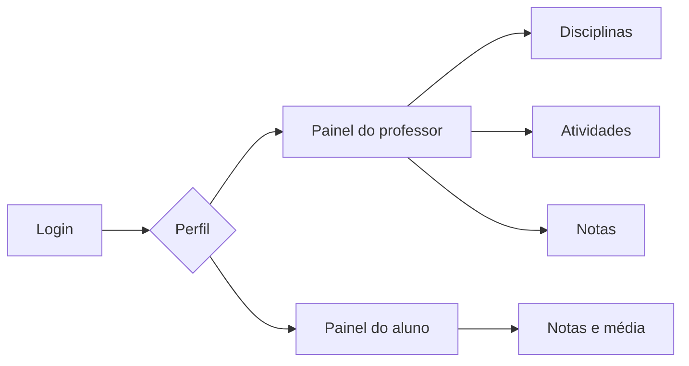

  

  # AcadFlow — Design

  Identidade visual, componentes, fluxos e telas do AcadFlow.

  [Documentação no Linear](https://linear.app/acadflow/document/acadflow-inicio-e-documentacao-9f01545a3125)

## Sobre

Este repositório reúne o design do AcadFlow, sistema para organizar disciplinas, atividades e notas. Ele é a referência visual para a [aplicação web](https://github.com/DevCaverna/acadflow-web), nas jornadas de professor e de aluno.

**Formatos:** `SVG` · `PNG` · `Canvas (.dc.html)`

## Fluxo

## Conteúdo

- `icone/`: ícone do projeto
  - `acadflow-icone.svg`: versão completa (a escrita "Acad" já está convertida em curvas, não precisa da fonte)
  - `acadflow-icone-simples.svg`: versão sem escrita, para tamanhos abaixo de 64 px
  - PNGs em 1024, 512, 192, 180 (Apple), 32 e 16 px (32 e 16 usam a versão simples)
- `design-files/`: código-fonte de todas as telas do canvas (um arquivo `.dc.html` por quadro) e `canvas.json` (páginas, posições e notas)

## Organização (páginas)

1. **Capa e ícone:** Main, Icone, LogoMark (componente)
2. **Fundamentos e componentes:** Fundamentos (cores, tipografia, espaçamento), Componentes, Sidebar (componente)
3. **Fluxos:** FluxoAuth, FluxoProfessor, FluxoAluno
4. **Autenticação:** Login, LoginCarregando, LoginErro, Cadastro (pós-MVP, somente `ALUNO`)
5. **Professor:** ProfPainel, ProfDisciplinas, ProfAtividades, ProfNotas, ProfPainelSkeleton, ProfPainelVazio, ProfNovaAtividade
6. **Aluno:** AlunoPainel, AlunoNotas, AlunoPainelSkeleton, AlunoPainelErro
7. **Erros e feedback:** Erro404, Erro403, Erro500, SemConexao, SessaoExpirada, Feedback

## Tokens principais

| Token | Valor |
| --- | --- |
| Primária (Tinta 600) | `#2E43C8` |
| Hover / pressionado | `#2436A8` / `#1C2A8C` |
| Destaque (Âmbar) | `#F2A93B` |
| Texto / texto secundário | `#151826` / `#5A6072` |
| Bordas / fundo do app | `#E4E6EE` / `#F5F6FA` |
| Sucesso / Erro / Recuperação | `#1C7A4A` / `#C0322A` / `#8A5300` |
| Fontes | Space Grotesk (títulos), Inter (interface), Caveat (só no ícone) |
| Raios | 6 campo · 10 botão · 14 card · 999 pílula |

Regra de situação usada: média ≥ 7,0 Aprovado · 5,0 a 6,9 Recuperação · < 5,0 Reprovado.

## Observação

Os arquivos `.dc.html` são o formato do canvas de design do Claude. Eles dependem do runtime do canvas e não abrem sozinhos no navegador nem importam direto no Figma. Servem como fonte e referência para os componentes React (estrutura, estilos e textos). O design navegável está no link do canvas.

## Documentação

| Página | O que tem |
| --- | --- |
| [Linear](https://linear.app/acadflow/document/acadflow-inicio-e-documentacao-9f01545a3125) | Início e documentação do projeto |
| [Telas](design-files/) | Fonte das telas e índice do canvas |
| [Ícone](icone/) | Ícone em SVG e PNG |

## Repositórios

- [acadflow-api](https://github.com/DevCaverna/acadflow-api)
- [acadflow-web](https://github.com/DevCaverna/acadflow-web)
